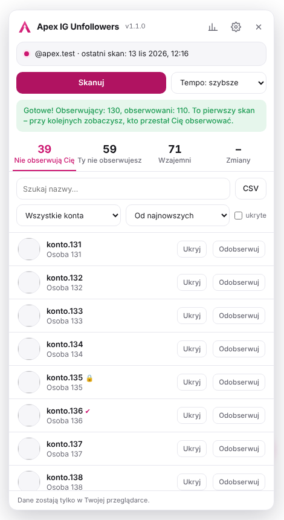
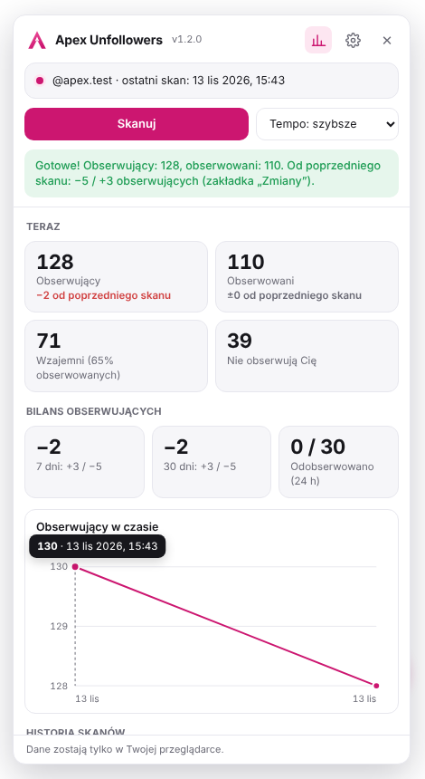
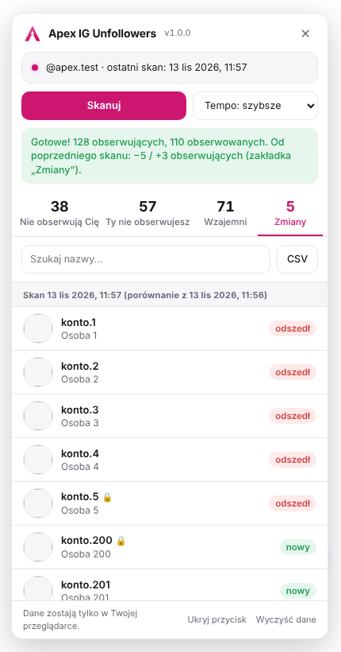
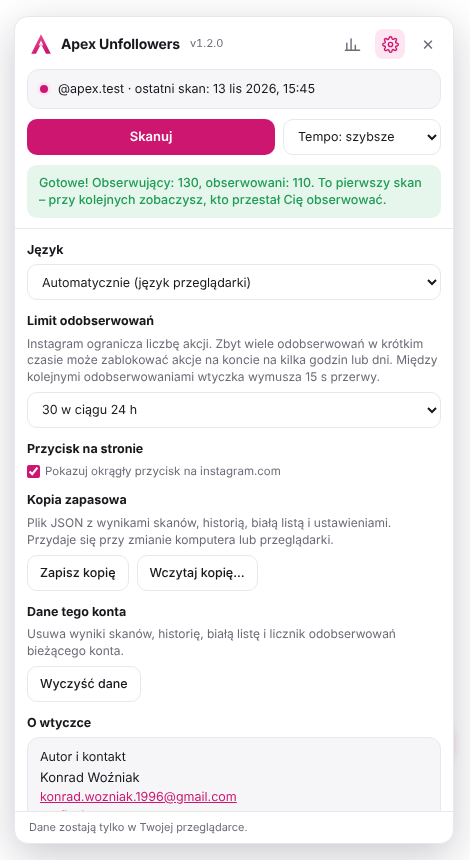
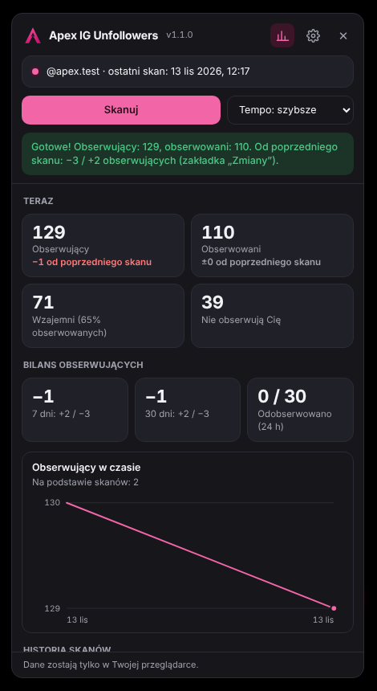

<p align="center">
  
</p>

<h1 align="center">Apex IG Unfollowers</h1>

<p align="center">
  <b>Polska, bezpłatna wtyczka o otwartym kodzie, która sprawdza, kto nie obserwuje Cię na Instagramie.<br>Działa lokalnie w przeglądarce: bez konta, bez serwera i bez telemetrii Apex.</b>
</p>

<p align="center">
  <a href="https://github.com/Bonziuu/Apex-IGUnfollowers/releases/latest/download/Apex-IGUnfollowers.zip"><b>⬇️ Pobierz ZIP</b></a>
  &nbsp;·&nbsp; <a href="#instalacja">Instalacja w 1 minutę</a>
  &nbsp;·&nbsp; <a href="https://github.com/Bonziuu/Apex-AdBlocker">Apex AdBlocker</a>
  &nbsp;·&nbsp; <a href="#eng">English ↓</a>
</p>

<p align="center">
  <a href="https://github.com/Bonziuu/Apex-IGUnfollowers/releases/latest"></a>
  <a href="LICENSE"></a>
</p>

> **Status:** wersja testowa 1.1.0. Wtyczki nie ma w Chrome Web Store – [pobierz ZIP](https://github.com/Bonziuu/Apex-IGUnfollowers/releases/latest/download/Apex-IGUnfollowers.zip) i zainstaluj ją ręcznie w minutę ([instrukcja](#instalacja)). Wszystkie wersje i sumy SHA-256: [Releases](https://github.com/Bonziuu/Apex-IGUnfollowers/releases/latest) · [Co nowego](CHANGELOG.md)

- 👥 Kto nie obserwuje Cię nawzajem
- 📉 Kto przestał Cię obserwować od ostatniego skanu
- 📊 Statystyki i wykres obserwujących
- 🔎 Filtry, sortowanie, biała lista, CSV
- 🔒 Bez konta, serwera i telemetrii Apex
- 🌍 Interfejs PL / EN
- 🧩 Manifest V3
- 🐢 Bezpieczne tempo zapytań
- 💻 Chrome 121+, Edge, Brave, Opera, Firefox 128+
- 🔓 Open source
- 🇵🇱 Rozwijany w Polsce

<p align="center">
  
  
  
</p>
<p align="center">
  
  
</p>
<p align="center"><sub>Prawdziwy interfejs wersji 1.1.0 na symulowanym Instagramie z testów (<code>npm test</code>). Konta na zrzutach są fikcyjne.</sub></p>

## Dlaczego Apex IG Unfollowers

- **Bez podawania hasła.** Wtyczka korzysta z sesji, w której już jesteś zalogowany na instagram.com. Nie ma zewnętrznego serwisu, który prosi o login i hasło.
- **Twoje dane zostają u Ciebie.** Listy obserwujących zapisują się wyłącznie w profilu przeglądarki. Nic nie jest wysyłane do autora ani do nikogo innego.
- **Bez automatów.** Skan tylko czyta listy. Jedyna akcja na koncie to ręczne „Odobserwuj” przy pojedynczej osobie: z potwierdzeniem, przerwą między kliknięciami i limitem dziennym. Nie ma masowego odobserwowywania ani lajkowania.
- **Ostrożna wobec konta.** Zapytania idą wolno, z losowymi przerwami. Gdy Instagram prosi o zwolnienie, wtyczka czeka zamiast próbować dalej.

## Funkcje

| | |
|---|---|
| **Nie obserwują Cię** | Konta, które obserwujesz, a które nie obserwują Ciebie. |
| **Ty nie obserwujesz** | Konta, które Cię obserwują, a których Ty nie obserwujesz. |
| **Wzajemni** | Konta, które obserwujecie nawzajem. |
| **Zmiany** | Kto przestał Cię obserwować i kto doszedł. Historia zapisuje się od drugiego skanu. |
| **Odobserwuj** | Przycisk przy każdym koncie, które obserwujesz. Wymaga potwierdzenia, ma 15 s przerwy między akcjami i dzienny limit (domyślnie 30 w ciągu 24 h, do zmiany w ustawieniach). |
| **Biała lista** | „Ukryj” chowa konta, od których nie oczekujesz obserwacji, np. celebrytów i marki. |
| **Filtry i sortowanie** | Zweryfikowane, prywatne, publiczne, bez zdjęcia profilowego; od najnowszych albo alfabetycznie. |
| **Statystyki** | Liczniki ze zmianą od poprzedniego skanu, bilans 7 i 30 dni, wykres obserwujących w czasie i tabela historii skanów. |
| **Wyszukiwarka i CSV** | Filtrowanie po nazwie i eksport widocznej listy do pliku CSV (Excel, Google Sheets). |
| **Kopia zapasowa** | Zapis i wczytanie wyników, historii, białej listy i ustawień w pliku JSON, np. przy zmianie komputera. |
| **Tempo** | „Bezpieczne” (domyślne) albo „szybsze” dla małych kont. Skan można zatrzymać w każdej chwili. |
| **PL / EN, jasny i ciemny motyw** | Język wg przeglądarki albo wybrany w ustawieniach; motyw wg systemu. |

## Prywatność

- **Bez konta** – nie ma rejestracji ani logowania do Apex.
- **Bez telemetrii Apex** – wtyczka nie wysyła autorowi żadnych danych ani statystyk.
- **Bez backendu Apex** – wyniki skanów, historia, biała lista, licznik odobserwowań i ustawienia zostają w `chrome.storage.local`. Usuniesz je w ustawieniach panelu („Wyczyść dane”) albo usuwając wtyczkę.
- **Jedyny adresat zapytań to instagram.com** – te same zapytania wysyła strona Instagrama, gdy otwierasz listę obserwujących albo klikasz „Przestań obserwować”.

Uprawnienia: `storage`, `unlimitedStorage` (duże listy obserwujących) i dostęp wyłącznie do `https://www.instagram.com/*`. Szczegóły: [polityka prywatności](PRIVACY.md).

## Bezpieczeństwo konta

Wtyczka korzysta z wewnętrznego API strony instagram.com, tego samego, którego używa sama strona. Regulamin Instagrama nie pozwala na automatyczne pobieranie danych, więc **używasz jej na własną odpowiedzialność**. Ryzyko ograniczają:

- losowe przerwy między stronami wyników i dłuższa pauza co kilka stron,
- automatyczne czekanie (60, 120, 180 s), gdy Instagram zwróci „zwolnij” (HTTP 429), a po trzech próbach przerwanie skanu,
- odobserwowanie wyłącznie ręczne, pojedynczo i z potwierdzeniem: 15 s przerwy między akcjami, limit dzienny (10–100, domyślnie 30),
- gdy Instagram zablokuje akcję („feedback_required”), wtyczka sama wstrzymuje odobserwowywanie na 6 godzin, a po HTTP 429 na godzinę.

Zalecenie: skanuj najwyżej raz dziennie i nie odobserwowuj dziesiątek kont naraz, zwłaszcza na nowym koncie. Przy kontach powyżej 10 tys. obserwujących zostaw tempo „bezpieczne”. Orientacyjny czas skanu w tempie „bezpiecznym” to około minuty na 1000 kont (obserwujący i obserwowani łącznie).

<a id="instalacja"></a>

## Instalacja

### Chrome, Edge, Brave, Opera

1. **[Pobierz `Apex-IGUnfollowers.zip`](https://github.com/Bonziuu/Apex-IGUnfollowers/releases/latest/download/Apex-IGUnfollowers.zip)** (zawsze najnowsza wersja).
2. Rozpakuj ZIP w stałym miejscu na dysku, np. w `Dokumenty`. Powstanie folder `Apex-IGUnfollowers`.
3. Wklej w pasek adresu `chrome://extensions` (w Edge: `edge://extensions`) i naciśnij Enter.
4. Włącz **Tryb dewelopera** w prawym górnym rogu.
5. Kliknij **Załaduj rozpakowane** i wskaż folder `Apex-IGUnfollowers`.
6. Otwórz [instagram.com](https://www.instagram.com) – w prawym dolnym rogu pojawi się różowy przycisk.

Nie usuwaj ani nie przenoś folderu po instalacji, bo przeglądarka korzysta z niego podczas działania wtyczki. Chrome może przy starcie pokazywać komunikat o rozszerzeniach w trybie dewelopera – to normalne dla wtyczek spoza sklepu.

**Weryfikacja pliku (opcjonalnie):** porównaj sumę SHA-256 z `SHA256SUMS.txt` z [tego samego wydania](https://github.com/Bonziuu/Apex-IGUnfollowers/releases/latest), np. `Get-FileHash .\Apex-IGUnfollowers.zip -Algorithm SHA256` (Windows) lub `shasum -a 256 Apex-IGUnfollowers.zip` (macOS, Linux).

### Firefox

- **Na próbę:** rozpakuj ten sam ZIP, wejdź na `about:debugging#/runtime/this-firefox`, kliknij **Załaduj tymczasowy dodatek** i wskaż `manifest.json` w folderze `Apex-IGUnfollowers`. Dodatek zniknie po zamknięciu Firefoksa.
- **Na stałe:** dodatek musi być podpisany przez Mozillę. Wyślij ZIP na [addons.mozilla.org/developers](https://addons.mozilla.org/developers/) jako dodatek do samodzielnej dystrybucji. To bezpłatne.
- Jeśli panel się nie pojawia: `about:addons`, potem Apex IG Unfollowers, zakładka **Uprawnienia** i włącz dostęp do `www.instagram.com`.

## Użycie

1. Otwórz [instagram.com](https://www.instagram.com) i zaloguj się.
2. Kliknij różowy przycisk w prawym dolnym rogu strony albo ikonę wtyczki na pasku przeglądarki.
3. Kliknij **Skanuj**. Panel możesz zamknąć w trakcie skanu, ale nie zamykaj karty.
4. Ikona wykresu w nagłówku panelu otwiera **statystyki**, a koło zębate **ustawienia** (język, limit odobserwowań, kopia zapasowa).

## Aktualizacja

[Pobierz nowy ZIP](https://github.com/Bonziuu/Apex-IGUnfollowers/releases/latest/download/Apex-IGUnfollowers.zip), zastąp pliki w tym samym folderze i kliknij **Odśwież** przy Apex IG Unfollowers w `chrome://extensions`. Wyniki skanów, historia i biała lista zostają w profilu przeglądarki. Przy przenosinach na inny komputer użyj kopii zapasowej z ustawień panelu.

## Dla programistów

```bash
npm ci && npm test                 # testy end-to-end na symulowanym Instagramie (Node.js 20+, Playwright)
SCREENSHOTS=1 npm test             # dodatkowo odświeża zrzuty w docs/screens/
npm run icons                      # ikony i logo z tools/build-icons.mjs
npm run package:release            # dist/Apex-IGUnfollowers-<wersja>.zip + SHA256SUMS.txt
```

| Plik | Rola |
|---|---|
| `manifest.json` | konfiguracja wtyczki (Manifest V3) |
| `content/unfollowers.js` | pobieranie list, porównanie, historia, statystyki, odobserwowanie, kopia zapasowa, panel (Shadow DOM) |
| `shared/i18n.js` | teksty interfejsu PL / EN (panel i okienko) |
| `_locales/` | nazwa i opis wtyczki w sklepie / `chrome://extensions` |
| `popup/` | okienko na pasku: otwiera i zamyka panel |
| `icons/`, `brand/` | ikony i logo (generowane przez `npm run icons`) |
| `tests/panel.test.mjs` | testy end-to-end: skan, filtry, statystyki, odobserwowanie (limit, przerwa, blokada), PL/EN, kopia zapasowa, HTTP 429 |

**Gdy Instagram zmieni API:** cała komunikacja z siecią jest w sekcji `// sieć` w `content/unfollowers.js`. `fetchListRest` to metoda główna (`/api/v1/friendships/{id}/followers|following/`), `fetchListGraphql` to metoda zapasowa (`query_hash`), `unfollowRequest` to odobserwowanie (`/api/v1/friendships/destroy/{id}/`, zapasowo `/web/friendships/{id}/unfollow/`), a `DEFAULT_APP_ID` to nagłówek `x-ig-app-id`. Aktualne zapytania podejrzysz w DevTools (F12), w zakładce **Network**, po otwarciu listy „Obserwujący” na instagram.com.

Każdy push i pull request uruchamia testy w GitHub Actions. **Nowe wydanie:** podbij `version` w `manifest.json`, dopisz sekcję w `CHANGELOG.md` i wypchnij na `main` – workflow „Wydanie” sam uruchomi testy i opublikuje paczkę ZIP z `SHA256SUMS.txt` (można też ręcznie: Actions → Wydanie → Run workflow).

## Wsparcie

- Problem z wtyczką: [zgłoś na GitHubie](https://github.com/Bonziuu/Apex-IGUnfollowers/issues). Podaj wersję przeglądarki i komunikat z panelu albo z konsoli (F12).
- Kontakt: support@apexsoftware.app

## Licencja

MIT, © 2026 Konrad Woźniak ([LICENSE](LICENSE)). Apex IG Unfollowers jest projektem niezależnym, niepowiązanym z Instagramem ani Meta Platforms. Instagram jest znakiem towarowym Meta Platforms, Inc.

---

<a id="eng"></a>

<h2 align="center">Apex IG Unfollowers — English</h2>

<p align="center">
  <b>A free, open-source browser extension that shows who doesn't follow you back on Instagram.<br>Runs locally in your browser: no account, no server, no Apex telemetry.</b>
</p>

> **Status:** preview release 1.1.0. Not on the Chrome Web Store – [download the ZIP](https://github.com/Bonziuu/Apex-IGUnfollowers/releases/latest/download/Apex-IGUnfollowers.zip) and install it manually in a minute.

- 👥 See who doesn't follow you back
- 📉 See who unfollowed you since the last scan
- 📊 Stats and a follower chart
- 🔎 Filters, sorting, whitelist, CSV export, JSON backup
- 🔒 No account, no server, no Apex telemetry
- 🌍 English and Polish interface
- 🧩 Manifest V3
- 🐢 Rate-limit-friendly scanning
- 💻 Chrome 121+, Edge, Brave, Opera, Firefox 128+
- 🔓 Open source

### How it works

The extension uses the session you are already logged into on instagram.com and reads your followers and following lists through the same internal endpoints the Instagram website uses. It never asks for your password. The only action it can take on your account is a manual **Unfollow** next to a single person, with a confirmation step, a 15-second break between unfollows and a daily limit (30 per 24 h by default). There is no bulk unfollowing. Results, history, your whitelist and settings are stored only in `chrome.storage.local`. The interface follows your browser language (English or Polish) or the language chosen in Settings.

Instagram's terms prohibit automated data collection, so **use it at your own risk**. Requests are paced with random delays, the extension backs off automatically when Instagram responds with HTTP 429, and it pauses unfollowing for 6 hours if Instagram blocks an action. Scanning at most once a day is recommended.

### Installation (Chrome, Edge, Brave, Opera)

1. **[Download `Apex-IGUnfollowers.zip`](https://github.com/Bonziuu/Apex-IGUnfollowers/releases/latest/download/Apex-IGUnfollowers.zip)** (always the latest release) and unpack it to a permanent folder.
2. Open `chrome://extensions`, enable **Developer mode**, click **Load unpacked** and select the `Apex-IGUnfollowers` folder.
3. Open instagram.com, log in, click the pink button in the bottom-right corner and press **Scan**.

On Firefox, load it temporarily from `about:debugging` or get it signed for free on [addons.mozilla.org](https://addons.mozilla.org/developers/).

### License

MIT, © 2026 Konrad Woźniak. Not affiliated with Instagram or Meta Platforms. Instagram is a trademark of Meta Platforms, Inc.
