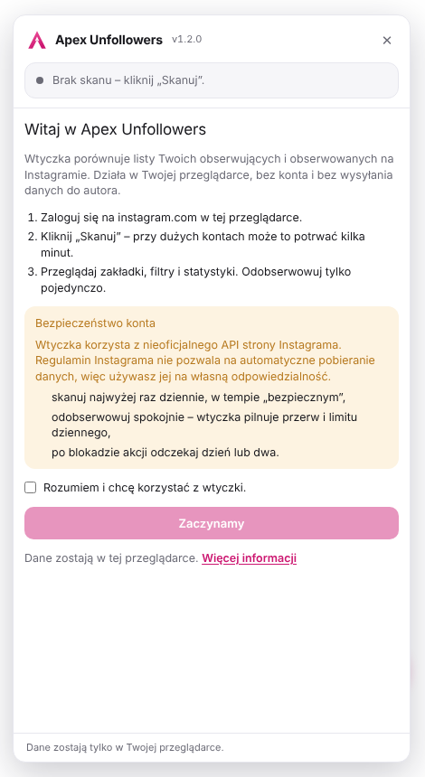

<p align="center">
  
</p>

<h1 align="center">Apex Unfollowers dla Instagrama</h1>

<p align="center">
  <b>Polska, bezpłatna wtyczka o otwartym kodzie, która sprawdza, kto nie obserwuje Cię na Instagramie.<br>Działa lokalnie w przeglądarce: bez konta, bez serwera i bez telemetrii Apex.</b>
</p>

<p align="center">
  <a href="https://github.com/Bonziuu/Apex-IGUnfollowers/releases/latest/download/Apex-Unfollowers.zip"><b>⬇️ Pobierz ZIP</b></a>
  &nbsp;·&nbsp; <a href="#instalacja">Instalacja w 1 minutę</a>
  &nbsp;·&nbsp; <a href="https://apexsoftware.app/pl/unfollowers/">Strona produktu</a>
  &nbsp;·&nbsp; <a href="#eng">English ↓</a>
</p>

<p align="center">
  <a href="https://github.com/Bonziuu/Apex-IGUnfollowers/releases/latest"></a>
  <a href="LICENSE"></a>
</p>

> **Status:** wersja 1.2.0. Do czasu publikacji w sklepach wtyczkę instaluje się ręcznie z [paczki ZIP](https://github.com/Bonziuu/Apex-IGUnfollowers/releases/latest/download/Apex-Unfollowers.zip) – zajmuje to minutę ([instrukcja](#instalacja)). Wszystkie wersje i sumy SHA-256: [Releases](https://github.com/Bonziuu/Apex-IGUnfollowers/releases/latest) · [Co nowego](CHANGELOG.md)

- 👥 Kto nie obserwuje Cię nawzajem
- 📉 Kto przestał Cię obserwować od ostatniego skanu
- 📊 Statystyki i wykres obserwujących
- 🔎 Filtry, sortowanie, biała lista, CSV
- ⏯️ Wznawianie przerwanego skanu przy dużych kontach
- 🔒 Bez konta, serwera i telemetrii Apex
- 🌍 Interfejs PL / EN
- 🧩 Manifest V3 · Chrome 121+, Edge, Brave, Opera, Firefox 142+
- 🔓 Open source · 🇵🇱 Rozwijany w Polsce

<p align="center">
  
  
  
</p>
<p align="center">
  
  
  
</p>
<p align="center"><sub>Prawdziwy interfejs wersji 1.2.0 na symulowanym Instagramie z testów (<code>npm test</code>). Konta na zrzutach są fikcyjne.</sub></p>

## Dlaczego Apex Unfollowers

- **Bez podawania hasła.** Wtyczka korzysta z sesji, w której już jesteś zalogowany na instagram.com. Nie ma zewnętrznego serwisu, który prosi o login i hasło.
- **Twoje dane zostają u Ciebie.** Listy obserwujących zapisują się wyłącznie w profilu przeglądarki. Nic nie jest wysyłane do autora ani do nikogo innego.
- **Bez automatów.** Skan tylko czyta listy. Jedyna akcja na koncie to ręczne „Odobserwuj” przy pojedynczej osobie: z potwierdzeniem, przerwą między kliknięciami i limitem dziennym. Nie ma masowego odobserwowywania ani lajkowania.
- **Ostrożna wobec konta.** Zapytania idą wolno, z losowymi przerwami. Gdy Instagram prosi o zwolnienie, wtyczka czeka zamiast próbować dalej.

## Funkcje

| | |
|---|---|
| **Nie obserwują Cię** | Konta, które obserwujesz, a które nie obserwują Ciebie. |
| **Ty nie obserwujesz** | Konta, które Cię obserwują, a których Ty nie obserwujesz. |
| **Wzajemni** | Konta, które obserwujecie nawzajem. |
| **Zmiany** | Kto przestał Cię obserwować i kto doszedł. Historia zapisuje się od drugiego skanu. |
| **Odobserwuj** | Przycisk przy każdym koncie, które obserwujesz. Wymaga potwierdzenia, ma 15 s przerwy między akcjami i dzienny limit (domyślnie 30 w ciągu 24 h, do zmiany w ustawieniach). Sukces liczy się dopiero po potwierdzeniu przez Instagram. |
| **Biała lista** | „Ukryj” chowa konta, od których nie oczekujesz obserwacji, np. celebrytów i marki. |
| **Filtry i sortowanie** | Zweryfikowane, prywatne, publiczne, bez zdjęcia profilowego; od najnowszych albo alfabetycznie. |
| **Statystyki** | Liczniki ze zmianą od poprzedniego skanu, bilans 7 i 30 dni, wykres obserwujących w czasie i tabela historii skanów. |
| **Wznawianie skanu** | Postęp zapisuje się w trakcie. Po zatrzymaniu, błędzie albo zamknięciu karty „Wznów skan” dokańcza pracę (przez 12 h). Pasek postępu pokazuje szacowany pozostały czas. |
| **Kompletność list** | Wynik jest porównywany z licznikami profilu; brakujące konta są dociągane, a niepełna lista daje wyraźne ostrzeżenie. |
| **Wyszukiwarka i CSV** | Filtrowanie po nazwie i eksport widocznej listy do pliku CSV (Excel, Google Sheets). |
| **Kopia zapasowa** | Zapis i wczytanie wyników, historii, białej listy i ustawień w pliku JSON, np. przy zmianie komputera. |
| **Zgłoś problem** | Przy każdym błędzie i w ustawieniach: gotowe zgłoszenie na GitHubie albo e-mail do autora. Zawiera tylko wersję, przeglądarkę i treść błędu – bez nazw kont. |
| **PL / EN, jasny i ciemny motyw** | Język wg przeglądarki albo wybrany w ustawieniach; motyw wg systemu. |

## Prywatność

- **Bez konta** – nie ma rejestracji ani logowania do Apex.
- **Bez telemetrii Apex** – wtyczka nie wysyła autorowi żadnych danych ani statystyk.
- **Bez backendu Apex** – wyniki skanów, historia, biała lista, licznik odobserwowań, postęp przerwanego skanu i ustawienia zostają w `chrome.storage.local`. Usuniesz je w ustawieniach panelu („Wyczyść dane”) albo usuwając wtyczkę.
- **Jedyny adresat zapytań to instagram.com** – te same zapytania wysyła strona Instagrama, gdy otwierasz listę obserwujących albo klikasz „Przestań obserwować”.

Uprawnienia: `storage`, `unlimitedStorage` (duże listy obserwujących) i dostęp wyłącznie do `https://www.instagram.com/*`. Skrypt tła służy tylko do otwarcia ekranu powitalnego. Szczegóły: [polityka prywatności](PRIVACY.md).

## Bezpieczeństwo konta

Wtyczka korzysta z wewnętrznego API strony instagram.com, tego samego, którego używa sama strona. Regulamin Instagrama nie pozwala na automatyczne pobieranie danych, więc **używasz jej na własną odpowiedzialność** – przypomina o tym ekran powitalny, który trzeba zaakceptować przy pierwszym uruchomieniu. Ryzyko ograniczają:

- losowe przerwy między stronami wyników i dłuższa pauza co kilka stron,
- automatyczne czekanie, gdy Instagram zwróci „zwolnij” (HTTP 429) albo stronę HTML zamiast danych, a po trzech próbach przerwanie skanu z zapisem postępu,
- odobserwowanie wyłącznie ręczne, pojedynczo i z potwierdzeniem: 15 s przerwy między akcjami, limit dzienny (10–100, domyślnie 30),
- gdy Instagram zablokuje akcję („feedback_required”), wtyczka sama wstrzymuje odobserwowywanie na 6 godzin, a po HTTP 429 na godzinę.

Zalecenie: skanuj najwyżej raz dziennie i nie odobserwowuj dziesiątek kont naraz, zwłaszcza na nowym koncie.

<a id="instalacja"></a>

## Instalacja

### Chrome, Edge, Brave, Opera

1. **[Pobierz `Apex-Unfollowers.zip`](https://github.com/Bonziuu/Apex-IGUnfollowers/releases/latest/download/Apex-Unfollowers.zip)** (zawsze najnowsza wersja).
2. Rozpakuj ZIP w stałym miejscu na dysku, np. w `Dokumenty`. Powstanie folder `Apex-Unfollowers`.
3. Wklej w pasek adresu `chrome://extensions` (w Edge: `edge://extensions`) i naciśnij Enter.
4. Włącz **Tryb dewelopera** w prawym górnym rogu.
5. Kliknij **Załaduj rozpakowane** i wskaż folder `Apex-Unfollowers`.
6. Otworzy się ekran powitalny. Zaakceptuj go i otwórz [instagram.com](https://www.instagram.com) – w prawym dolnym rogu pojawi się różowy przycisk.

Nie usuwaj ani nie przenoś folderu po instalacji, bo przeglądarka korzysta z niego podczas działania wtyczki. Chrome może przy starcie pokazywać komunikat o rozszerzeniach w trybie dewelopera – to normalne dla wtyczek spoza sklepu.

**Weryfikacja pliku (opcjonalnie):** porównaj sumę SHA-256 z `SHA256SUMS.txt` z [tego samego wydania](https://github.com/Bonziuu/Apex-IGUnfollowers/releases/latest), np. `Get-FileHash .\Apex-Unfollowers.zip -Algorithm SHA256` (Windows) lub `shasum -a 256 Apex-Unfollowers.zip` (macOS, Linux).

### Firefox

- **Na próbę:** rozpakuj ten sam ZIP, wejdź na `about:debugging#/runtime/this-firefox`, kliknij **Załaduj tymczasowy dodatek** i wskaż `manifest.json` w folderze `Apex-Unfollowers`. Dodatek zniknie po zamknięciu Firefoksa.
- **Na stałe:** dodatek musi być podpisany przez Mozillę – materiały do zgłoszenia są w [docs/webstore](docs/webstore/README.md).
- Jeśli panel się nie pojawia: `about:addons`, potem Apex Unfollowers, zakładka **Uprawnienia** i włącz dostęp do `www.instagram.com`.

## Użycie

1. Otwórz [instagram.com](https://www.instagram.com) i zaloguj się.
2. Kliknij różowy przycisk w prawym dolnym rogu strony albo ikonę wtyczki na pasku przeglądarki.
3. Kliknij **Skanuj**. Panel możesz zamknąć w trakcie skanu, ale nie zamykaj karty. Jeśli skan się przerwie, kliknij **Wznów skan**.
4. Ikona wykresu w nagłówku panelu otwiera **statystyki**, a koło zębate **ustawienia** (język, limit odobserwowań, kopia zapasowa, autor i kontakt, zgłaszanie problemów).

## Aktualizacja

[Pobierz nowy ZIP](https://github.com/Bonziuu/Apex-IGUnfollowers/releases/latest/download/Apex-Unfollowers.zip), zastąp pliki w tym samym folderze i kliknij **Odśwież** przy Apex Unfollowers w `chrome://extensions`. Wyniki skanów, historia i biała lista zostają w profilu przeglądarki. Przy przenosinach na inny komputer użyj kopii zapasowej z ustawień panelu.

> Aktualizacja z wersji 1.1.x: folder w paczce nazywa się teraz `Apex-Unfollowers`. Najprościej skopiuj jego zawartość do starego folderu i kliknij **Odśwież**. Jeśli instalujesz wtyczkę w nowym miejscu, Chrome potraktuje ją jak nową – przed usunięciem starej zapisz kopię zapasową (ustawienia panelu) i wczytaj ją w nowej.

## Dla programistów

```bash
npm ci && npm test                 # testy end-to-end na symulowanym Instagramie (Node.js 20+, Playwright)
SCREENSHOTS=1 npm test             # dodatkowo odświeża zrzuty w docs/screens/
npm run icons                      # ikony i logo z tools/build-icons.mjs
npm run store                      # zrzuty i grafiki do sklepów (store/)
npm run package:release            # dist/Apex-Unfollowers-<wersja>.zip + SHA256SUMS.txt
```

| Plik | Rola |
|---|---|
| `manifest.json` | konfiguracja wtyczki (Manifest V3) |
| `content/core.js` | przeglądarka, stałe, zapis lokalny, stan, porównywanie list |
| `content/net.js` | zapytania do instagram.com: listy, liczniki, odobserwowanie |
| `content/actions.js` | skan ze wznawianiem i szacowanym czasem, odobserwowanie, kopia zapasowa, zgłaszanie problemów |
| `content/ui.js`, `content/views.js` | panel (Shadow DOM), listy, statystyki z wykresem, ekran powitalny, CSV |
| `content/main.js` | start panelu i komunikacja z okienkiem na pasku |
| `shared/i18n.js`, `_locales/` | teksty PL / EN |
| `background.js`, `welcome/` | ekran powitalny po instalacji |
| `popup/` | okienko na pasku: otwiera i zamyka panel |
| `icons/`, `brand/`, `store/`, `docs/webstore/` | grafika, materiały i teksty do sklepów |
| `tests/panel.test.mjs` | testy end-to-end |

Moduły `content/*.js` ładują się po kolei (kolejność w `manifest.json`) i dzielą jedną przestrzeń nazw skryptów wtyczki, dlatego deklaracje na najwyższym poziomie używają `var` / `function`.

**Gdy Instagram zmieni API:** cała komunikacja z siecią jest w `content/net.js`. `fetchListRest` pobiera listy (`/api/v1/friendships/{id}/followers|following/`), `unfollowRequest` odobserwowuje (`/api/v1/friendships/destroy/{id}/` z tokenami sesji strony), a `igHeaders` składa nagłówki klienta www. Aktualne zapytania podejrzysz w DevTools (F12) w zakładce **Network** po otwarciu listy „Obserwujący” na instagram.com.

Każdy push i pull request uruchamia testy w GitHub Actions. **Nowe wydanie:** podbij `version` w `manifest.json`, dopisz sekcję w `CHANGELOG.md` i wypchnij na `main` – workflow „Wydanie” sam uruchomi testy i opublikuje paczkę ZIP z `SHA256SUMS.txt` (można też ręcznie: Actions → Wydanie → Run workflow).

## Wsparcie

- Problem z wtyczką: przycisk **Zgłoś problem** w panelu albo [zgłoszenie na GitHubie](https://github.com/Bonziuu/Apex-IGUnfollowers/issues/new/choose).
- Autor: **Konrad Woźniak** · konrad.wozniak.1996@gmail.com · [LinkedIn](https://www.linkedin.com/in/konrad-wo%C5%BAniak-23a5b831a) · [apexsoftware.app](https://apexsoftware.app)
- Prywatność: support@apexsoftware.app

## Licencja

MIT, © 2026 Konrad Woźniak ([LICENSE](LICENSE)). Sposób odobserwowywania opracowano na podstawie projektu InstagramUnfollowers (MIT) – [THIRD_PARTY_NOTICES.md](THIRD_PARTY_NOTICES.md). Apex Unfollowers jest projektem niezależnym, niepowiązanym z Instagramem ani Meta Platforms. Instagram jest znakiem towarowym Meta Platforms, Inc.

---

<a id="eng"></a>

<h2 align="center">Apex Unfollowers for Instagram — English</h2>

<p align="center">
  <b>A free, open-source browser extension that shows who doesn't follow you back on Instagram.<br>Runs locally in your browser: no account, no server, no Apex telemetry.</b>
</p>

> **Status:** release 1.2.0. Until it is published in the browser stores, [download the ZIP](https://github.com/Bonziuu/Apex-IGUnfollowers/releases/latest/download/Apex-Unfollowers.zip) and install it manually in a minute. Product page: [apexsoftware.app/en/unfollowers](https://apexsoftware.app/en/unfollowers/).

- 👥 See who doesn't follow you back
- 📉 See who unfollowed you since the last scan
- 📊 Stats and a follower chart
- 🔎 Filters, sorting, whitelist, CSV export, JSON backup
- ⏯️ Resumable scans for large accounts, with a time estimate
- 🔒 No account, no server, no Apex telemetry
- 🌍 English and Polish interface
- 🧩 Manifest V3 · Chrome 121+, Edge, Brave, Opera, Firefox 142+

### How it works

The extension uses the session you are already logged into on instagram.com and reads your followers and following lists through the same internal endpoints the Instagram website uses. It never asks for your password. The only action it can take on your account is a manual **Unfollow** next to a single person, with a confirmation step, a 15-second break between unfollows and a daily limit (30 per 24 h by default). There is no bulk unfollowing. Results, history, your whitelist, scan progress and settings are stored only in `chrome.storage.local`. A **Report a problem** button opens a pre-filled GitHub issue or e-mail with the version, browser and error only – no account names.

Instagram's terms prohibit automated data collection, so **use it at your own risk** – the welcome screen asks you to confirm this on first run. Requests are paced with random delays, the extension backs off automatically when Instagram responds with HTTP 429, and it pauses unfollowing for 6 hours if Instagram blocks an action. Scanning at most once a day is recommended.

### Installation (Chrome, Edge, Brave, Opera)

1. **[Download `Apex-Unfollowers.zip`](https://github.com/Bonziuu/Apex-IGUnfollowers/releases/latest/download/Apex-Unfollowers.zip)** (always the latest release) and unpack it to a permanent folder.
2. Open `chrome://extensions`, enable **Developer mode**, click **Load unpacked** and select the `Apex-Unfollowers` folder.
3. Accept the welcome screen, open instagram.com, click the pink button in the bottom-right corner and press **Scan**.

On Firefox, load it temporarily from `about:debugging` or get it signed for free on [addons.mozilla.org](https://addons.mozilla.org/developers/).

### Support and licence

Report a problem from the panel or on [GitHub](https://github.com/Bonziuu/Apex-IGUnfollowers/issues/new/choose). Author: Konrad Woźniak · konrad.wozniak.1996@gmail.com. MIT, © 2026 Konrad Woźniak. Not affiliated with Instagram or Meta Platforms. Instagram is a trademark of Meta Platforms, Inc.
