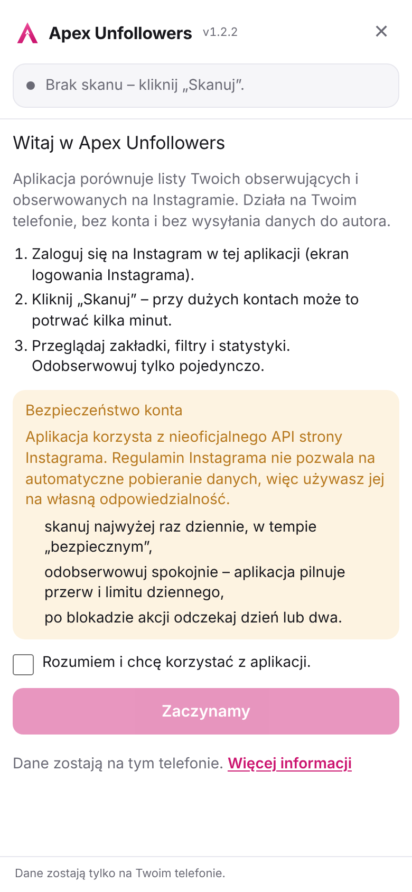
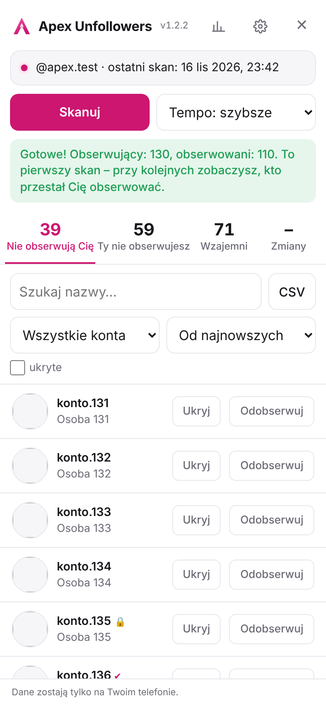
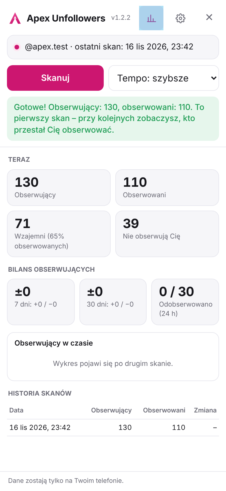
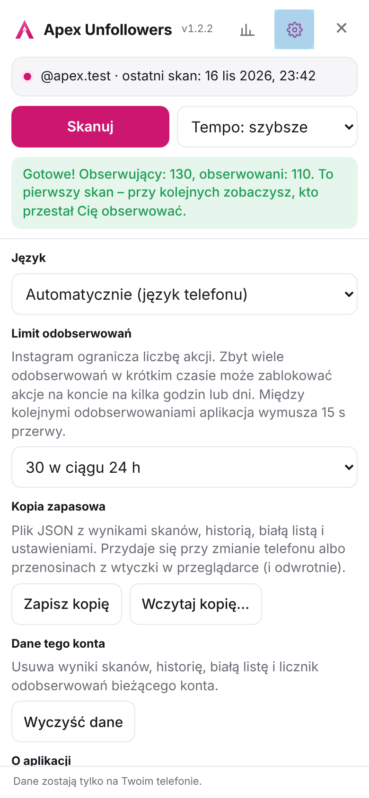

# Apex Unfollowers – aplikacja na telefon (Android i iPhone)

Ten sam panel co we wtyczce Chrome, jako aplikacja na telefon. **Bez reklam, bez analityki, bez konta i bez serwera Apex** – aplikacja łączy się wyłącznie z Instagramem.

<p align="center">
  
  
  
  
</p>

## Jak to działa

Aplikacja otwiera mobilną stronę instagram.com we wbudowanym oknie przeglądarki. Logujesz się na zwykłym ekranie Instagrama – hasło trafia tylko do Instagrama, nie do aplikacji. Po zalogowaniu panel Apex Unfollowers otwiera się sam (różowy przycisk w prawym dolnym rogu otwiera go ponownie).

Panel to dokładnie ten sam kod co we wtyczce (`content/*.js`): te same listy, statystyki, biała lista, wznawianie skanu, limity i przerwy przy odobserwowaniu. Różnice:

- wyniki skanów zapisują się w prywatnej pamięci aplikacji (nie trafiają do kopii w chmurze),
- CSV i kopia zapasowa zapisują się przez systemowe okno „Zapisz” (Android) / „Udostępnij → Zachowaj w Plikach” (iPhone),
- profil z listy otwiera się w aplikacji Instagram (jeśli jest zainstalowana) albo w przeglądarce,
- przycisk „Wstecz” na Androidzie najpierw zamyka panel.

Kopia zapasowa JSON jest zgodna z wtyczką – możesz przenieść wyniki z komputera na telefon i odwrotnie.

## Instalacja na Androidzie

1. Na telefonie otwórz **[Apex-Unfollowers.apk](https://github.com/Bonziuu/Apex-IGUnfollowers/releases/latest/download/Apex-Unfollowers.apk)** i pobierz plik.
2. Otwórz pobrany plik. Android zapyta o zgodę na instalację z tego źródła (przeglądarki / menedżera plików) – zezwól.
3. Jeśli pojawi się Google Play Protect („Nieznana aplikacja”), wybierz **Więcej szczegółów → Zainstaluj mimo to**. To normalne dla aplikacji spoza Sklepu Play.
4. Otwórz **Apex Unfollowers**, zaloguj się na Instagram, zaakceptuj ekran powitalny i kliknij **Skanuj**.

Wymagania: Android 7.0 lub nowszy z aktualnym „Android System WebView” (aktualizuje się w Sklepie Play).

**Aktualizacja:** pobierz nowy APK z tego samego linku i zainstaluj go „na” starą wersję – wyniki zostają.

## Instalacja na iPhonie

Apple pozwala instalować aplikacje spoza App Store tylko po podpisaniu ich Twoim Apple ID. Plik **[Apex-Unfollowers.ipa](https://github.com/Bonziuu/Apex-IGUnfollowers/releases/latest/download/Apex-Unfollowers.ipa)** jest gotowy, ale bez podpisu – podpisuje go narzędzie do instalacji:

- **AltStore / SideStore** (darmowe, z komputera Windows lub Mac): zainstaluj AltStore według instrukcji na altstore.io, otwórz w nim plik `.ipa` (**My Apps → +**). Z darmowym Apple ID podpis trzeba odnawiać co 7 dni (AltStore robi to sam, gdy telefon i komputer są w tej samej sieci).
- **Sideloadly** (Windows / Mac): przeciągnij `.ipa`, podaj Apple ID, kliknij **Start**.
- **Xcode na Macu** (bez dodatkowych narzędzi): `brew install xcodegen && npm ci && npm run mobile && cd ios && xcodegen generate && open ApexUnfollowers.xcodeproj`, w **Signing & Capabilities** wybierz swój zespół (Apple ID) i uruchom na podłączonym iPhonie.
- Z płatnym kontem Apple Developer (99 USD/rok) możesz podpisać aplikację na rok albo rozdać ją przez TestFlight.

Za pierwszym razem: **Ustawienia → Ogólne → VPN i urządzenia** → zaufaj swojemu Apple ID, a na iOS 16+ włącz **Ustawienia → Prywatność i ochrona → Tryb dewelopera**.

Wymagania: iOS 15 lub nowszy.

## Bezpieczeństwo konta

Takie samo jak we wtyczce: aplikacja korzysta z nieoficjalnego API strony Instagrama, a regulamin Instagrama nie pozwala na automatyczne pobieranie danych – **używasz jej na własną odpowiedzialność**. Zapytania idą wolno i z przerwami, odobserwowanie jest tylko ręczne, pojedynczo, z potwierdzeniem i dziennym limitem. Skanuj najwyżej raz dziennie.

## Dla programistów

```bash
npm ci
npm run mobile                      # mobile/dist/apex-unfollowers.js + kopie w android/ i ios/
node --test tests/mobile.test.mjs   # test paczki na ekranie telefonu (Playwright, symulowany Instagram)

# Android (JDK 17, Android SDK; albo otwórz katalog android/ w Android Studio)
gradle -p android assembleRelease   # android/app/build/outputs/apk/release/app-release.apk

# iPhone (macOS, Xcode 16)
cd ios && xcodegen generate && open ApexUnfollowers.xcodeproj
```

| Plik | Rola |
|---|---|
| `mobile/web/bridge.js` | most do aplikacji i zamiennik `chrome.storage` / `chrome.runtime` |
| `mobile/web/overrides.js` | układ na telefon, teksty „aplikacja”, zapis plików i linki przez system |
| `tools/build-mobile.mjs` | skleja `bridge.js` + `shared/i18n.js` + `content/*.js` + `overrides.js` w jeden skrypt |
| `android/` | aplikacja Android (Kotlin, WebView, `addWebMessageListener` + `addDocumentStartJavaScript`) |
| `ios/` | aplikacja iOS (Swift, WKWebView, `WKScriptMessageHandlerWithReply`), projekt z XcodeGen |
| `.github/workflows/mobile.yml` | test, budowa APK i IPA, dołączenie do wydania |

Most przyjmuje wiadomości tylko z głównej ramki `https://www.instagram.com`. Operacje: `get`, `set`, `remove`, `clear` (pamięć: klucz → tekst JSON, plik na klucz), `save` (zapis pliku), `open` (link w systemie; tylko `https`, `http`, `mailto`).

### Podpis APK (jednorazowo)

Android instaluje aktualizację tylko wtedy, gdy jest podpisana tym samym kluczem. Żeby każda wersja z GitHuba instalowała się „na” poprzednią, dodaj w repozytorium **Settings → Secrets and variables → Actions → New repository secret**:

| Sekret | Wartość |
|---|---|
| `ANDROID_KEYSTORE_BASE64` | plik `.jks` zakodowany base64 (`base64 -w0 apex-release.jks`), alias klucza `apex` |
| `ANDROID_KEYSTORE_PASSWORD` | hasło do pliku i klucza |

Nowy klucz: `keytool -genkeypair -v -keystore apex-release.jks -alias apex -keyalg RSA -keysize 4096 -validity 36500 -dname "CN=Apex Unfollowers"`. Zachowaj plik i hasło w bezpiecznym miejscu – bez nich nie wydasz aktualizacji, którą da się zainstalować na istniejącą aplikację. Bez sekretów workflow podpisuje APK kluczem testowym (inny przy każdej budowie).
